<picture><source media="(prefers-color-scheme: dark)" srcset="assets/hero-dark.svg"></picture>

<a href="https://t.me/"><picture><source media="(prefers-color-scheme: dark)" srcset="assets/social-1-dark.svg"></picture></a>&nbsp;<a href="https://discord.com/"><picture><source media="(prefers-color-scheme: dark)" srcset="assets/social-2-dark.svg"></picture></a>&nbsp;<a href="https://x.com/"><picture><source media="(prefers-color-scheme: dark)" srcset="assets/social-3-dark.svg"></picture></a>&nbsp;<a href="https://github.com"><picture><source media="(prefers-color-scheme: dark)" srcset="assets/social-4-dark.svg"></picture></a>&nbsp;<a href="https://www.instagram.com"><picture><source media="(prefers-color-scheme: dark)" srcset="assets/social-5-dark.svg"></picture></a>&nbsp;<a href="https://www.tiktok.comhttps://www.tiktok.com"><picture><source media="(prefers-color-scheme: dark)" srcset="assets/social-6-dark.svg"></picture></a>&nbsp;<a href="https://www.twitch.tv"><picture><source media="(prefers-color-scheme: dark)" srcset="assets/social-7-dark.svg"></picture></a>&nbsp;<a href="https://www.rockstargames.com/us/"><picture><source media="(prefers-color-scheme: dark)" srcset="assets/social-8-dark.svg"></picture></a>

<picture><source media="(prefers-color-scheme: dark)" srcset="assets/about-dark.svg"></picture>

<picture><source media="(prefers-color-scheme: dark)" srcset="assets/stack-dark.svg"></picture>

<a href="https://github.com/ebayybe/reddit-translator"><picture><source media="(prefers-color-scheme: dark)" srcset="assets/project-reddit-translator-dark.svg"></picture></a>&nbsp;<a href="https://github.com/ebayybe/kick-stream-tweaks"><picture><source media="(prefers-color-scheme: dark)" srcset="assets/project-kick-stream-tweaks-dark.svg"></picture></a>

<a href="https://github.com/ebayybe/DemoScope"><picture><source media="(prefers-color-scheme: dark)" srcset="assets/project-demoscope-dark.svg"></picture></a>

<picture><source media="(prefers-color-scheme: dark)" srcset="assets/stats-dark.svg"></picture>

<picture><source media="(prefers-color-scheme: dark)" srcset="assets/streak-dark.svg"></picture>

<picture><source media="(prefers-color-scheme: dark)" srcset="assets/wave-dark.svg"></picture>

<picture><source media="(prefers-color-scheme: dark)" srcset="assets/button-l-dark.svg"></picture><a href="https://example.com"><picture><source media="(prefers-color-scheme: dark)" srcset="assets/button-1-dark.svg"></picture></a><a href="https://github.com/ebayybe?tab=repositories"><picture><source media="(prefers-color-scheme: dark)" srcset="assets/button-2-dark.svg"></picture></a><picture><source media="(prefers-color-scheme: dark)" srcset="assets/button-r-dark.svg"></picture>

<a href="https://metawka.github.io/expressive-profile/?from=ebayybe"><picture><source media="(prefers-color-scheme: dark)" srcset="assets/credit-dark.svg"></picture></a>

